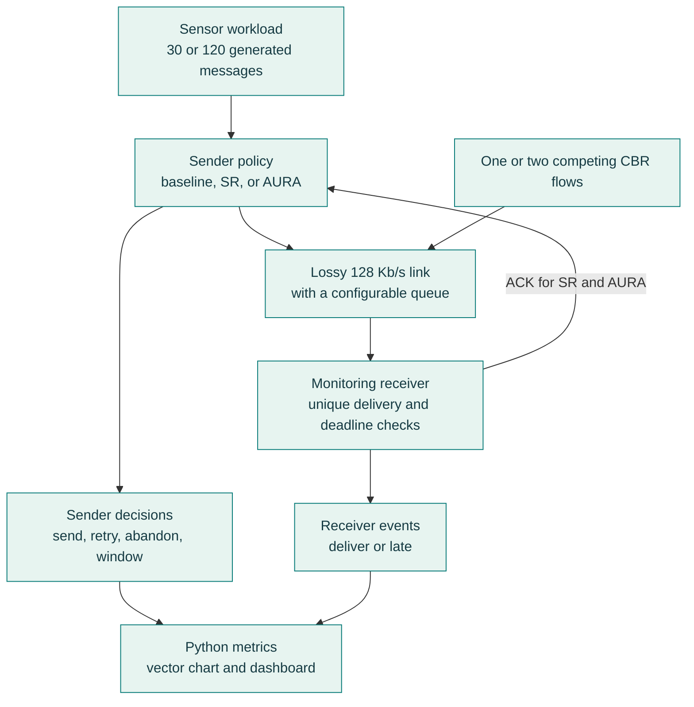
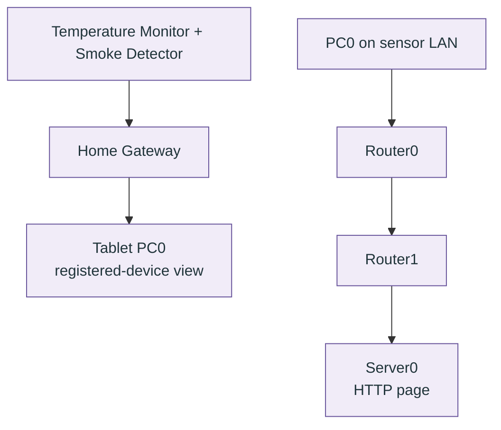
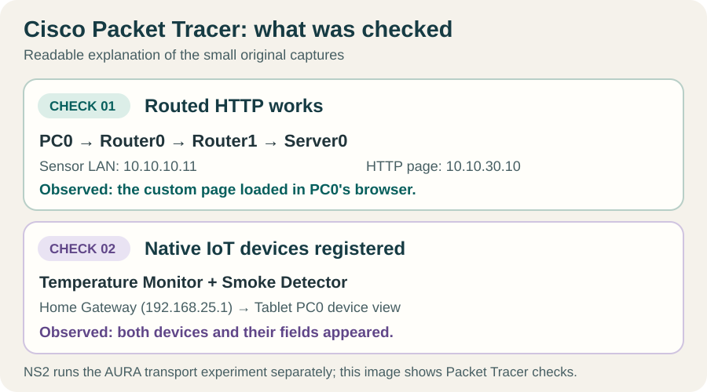
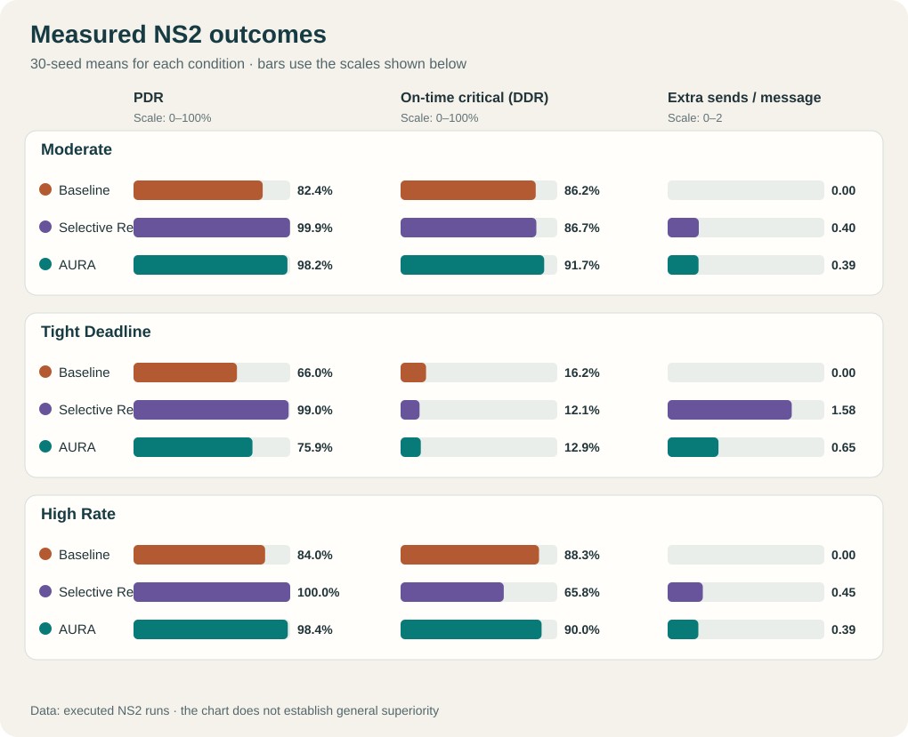
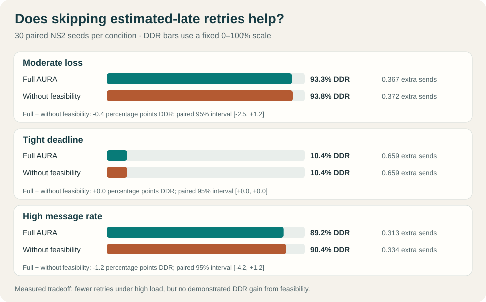
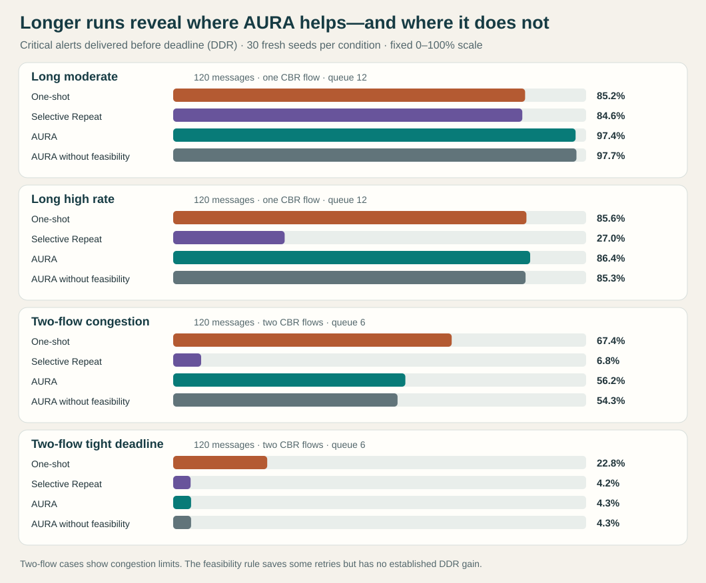

# AURA-UDP

[](https://github.com/purvi126/AURA-UDP/actions/workflows/python.yml)

[Download the v1.2.0 research evaluation release](https://github.com/purvi126/AURA-UDP/releases/tag/v1.2.0), a stable rollback checkpoint with the editable Packet Tracer topology and the first 1,260 NS2 runs. The current `main` branch adds [480 longer, crowded runs](experiments/results/robustness/summary.csv), a [360-run alert-reservation study](experiments/results/reservation/summary.csv), and a Packet Tracer smoke stimulus device. The earlier [v1.1.0](https://github.com/purvi126/AURA-UDP/releases/tag/v1.1.0) and [v1.0.0](https://github.com/purvi126/AURA-UDP/releases/tag/v1.0.0) releases remain available.

**Release status:** the new admission policy is committed on `main` for review, but no newer release has been published while the native Packet Tracer smoke-alarm transition remains unverified.

**Computer Networks Lab Review 2:** [seven-page PDF](docs/reviews/AURA-UDP-Review-2-70-percent-progress.pdf) · [editable Word document](docs/reviews/AURA-UDP-Review-2-70-percent-progress.docx). Prepared by Purvi Valmeti and M Harshita Sri, it explains the implementation, NS2 results, Packet Tracer captures, and remaining work. The approximately 70–75% milestone is a project planning estimate.

**Deadline-Aware Adaptive Reliable Transport for Critical IoT Communication Using NS2 and Cisco Packet Tracer**

This Computer Networks Lab project studies whether application-layer reliability and deadline awareness help safety alerts in a smart-campus network. **NS2 2.35 runs the transport experiment**: it compares one-shot datagrams, fixed Selective Repeat, and AURA. **Cisco Packet Tracer models the campus**: its editable topology shows routers, a server, an IoT gateway, and registered temperature and smoke devices. These are two complementary demonstrations, not one connected runtime. Start with the [plain-language project guide](docs/PROJECT_EXPLAINED.md) if the terms are new.

## Architecture

The same campus question is explored in two independent tools. **NS2 produces performance measurements. Packet Tracer demonstrates the physical layout and working endpoints.**

### NS2: where AURA actually runs



For SR and AURA, the receiver sends acknowledgments back to the source; the source controls retries and critical-alert deadlines. The other sender adds traffic at the bottleneck.

### Cisco Packet Tracer: where the campus is built



The sensor-to-gateway view and PC0-to-server HTTP route are **two separate checks** in the saved topology. No Packet Tracer sensor sends packets into NS2, and the Packet Tracer HTTP page does not execute AURA.

| Where to look | What is implemented there |
|---|---|
| [ns2/run.tcl](ns2/run.tcl) | NS2 nodes, links, loss, traffic, baseline/SR/AURA sender behavior, ACKs, deadlines, and event logs. |
| [scripts/multiseed.py](scripts/multiseed.py), [scripts/ablation.py](scripts/ablation.py), [scripts/robustness.py](scripts/robustness.py), [scripts/reservation_study.py](scripts/reservation_study.py), and [python/analysis/metrics.py](python/analysis/metrics.py) | Repeat NS2 runs, isolate policy choices, test longer crowded workloads and the alert-slot candidate, and turn logs into measured results. |
| [python/dashboard/index.html](python/dashboard/index.html) | Explore the saved NS2 results and message events; it does not run a simulation. |
| [AURA-UDP-campus.pkt](packet_tracer/topology/AURA-UDP-campus.pkt) | Editable Cisco Packet Tracer campus with routed PCs, Server0, Home Gateway, Temperature Monitor, and Smoke Detector. |
| [server-index.html](packet_tracer/documentation/server-index.html) and [build guide](packet_tracer/documentation/BUILD_GUIDE.md) | Source of Server0's HTTP page, address plan, and steps to inspect the Packet Tracer paths. |

Numbered datagrams and ACKs are carried by NS2 `Agent/Message` instances. The sender retries individually; the receiver suppresses duplicate delivery. AURA adds deadline-ordered alert admission, a routine-traffic guard, an explicit estimate of whether a retry can arrive in time, RTT-based timing, and a bounded 4–6-message congestion window. An **experimental alert-reservation policy** keeps one sender slot free when only routine messages are waiting. See the [policy specification](docs/PROTOCOL.md). The [evaluation](docs/RESEARCH_EVALUATION.md) reports where that change helps and where the one-shot baseline still wins.

## Requirements and quick start

- Ubuntu WSL with NS2 2.35 (`ns` on `PATH`)
- Python 3.10 or newer, standard library only
- Cisco Packet Tracer 9.0 for the separate topology demonstration

From `/mnt/d/projects/AURA-UDP`:

```bash
python3 -m unittest discover -s tests -v
python3 scripts/experiments.py --output experiments/results/sample
python3 scripts/multiseed.py
python3 scripts/ablation.py
python3 scripts/robustness.py
python3 scripts/reservation_study.py
python3 python/analysis/plot.py experiments/results/sample/summary.csv experiments/plots/sample.svg
python3 scripts/plot_robustness.py
```

To use the dashboard, start a local server **from the repository root in a separate terminal** and leave it running:

```bash
python3 -m http.server 8000 --bind 127.0.0.1
```

Then open [the local dashboard](http://localhost:8000/python/dashboard/). It guides you through five steps: choose a network condition, compare transports, test the deadline rule, inspect the alert-reservation study, and follow one recorded message. If the browser says the page cannot be reached, check that the server terminal is still running and that you started it from the repository root. On Windows, use `python -m http.server 8000 --bind 127.0.0.1`. The server is for local review, not deployment.

Run a single mode:

```bash
ns ns2/run.tcl aura 0.15 40 80 300 7 /tmp/aura-demo
python3 python/analysis/metrics.py /tmp/aura-demo/events.csv
```

The NS2 command arguments are `mode loss_probability delay_ms background_kbps deadline_ms seed output_directory [interval_ms] [policy] [message_count] [background_sources] [queue_limit]`. The last three default to `30`, `1`, and `12`; background sources can be one or two and split the configured total CBR rate. Policy variants apply only to AURA; `full` is the default and `reserved_alert_slot` is the new candidate. The output contains `events.csv`, `control.csv`, `background.csv`, `ns2.tr`, and `ns2.nam`. NAM is optional for analysis. Each mode uses the same configured topology and generation schedule, with paired seed indices for the loss streams; transport choices can consume different draws, so individual packet losses are not identical.

## Measured sample

The checked-in sample comes from `loss=0.15`, `delay=40 ms`, `background=80 Kb/s`, `deadline=300 ms`, `seed=7`. It is a single short run and supports no broad performance claim. Open [sample results](experiments/results/sample/summary.csv) and [the plot](experiments/plots/sample.svg). Re-run to regenerate them. Under a stronger scenario, `loss=0.3`, `delay=80 ms`, `background=180 Kb/s`, `deadline=120 ms`, `seed=11`, AURA did **not** improve DDR over the other modes; [stress results](experiments/results/stress/summary.csv) and [stress plot](experiments/plots/stress.svg) show the limitation.

## Demonstration

1. Run the tests and experiments above. Compare PDR, DDR, delay, retransmission overhead and goodput in the CSV and SVG.
2. Inspect `events.csv` for `generate`, `send`, `timeout`, `receive`, `duplicate`, `deliver`, `late`, `ack`, `expire`, and `abandon` transitions. `control.csv` shows retry timer and window decisions; `background.csv` records the competing flow's received packets.
3. Optionally open `ns2.nam` with NAM if installed; no result calculation depends on NAM.
4. Open the editable [Packet Tracer campus topology](packet_tracer/topology/AURA-UDP-campus.pkt). From sensor-side PC0, browse to `http://10.10.30.10` to verify HTTP across both routers. From Tablet PC0, browse to `http://192.168.25.1`, sign in to the lab gateway, and inspect the registered temperature and smoke devices. The [build guide](packet_tracer/documentation/BUILD_GUIDE.md) has the full address plan.

### Packet Tracer evidence, made readable



This vector diagram is a **readable explanation of observed checks**, not a substitute for a Packet Tracer capture. The original [PC0 routed HTTP screenshot](packet_tracer/documentation/media/routed-http-pc0.jpg) is only 513 pixels wide, so its small text becomes blurry when enlarged in GitHub's README. Open the original at native size if you need to inspect the PC0 title bar and `10.10.30.10` address. The [Home Gateway screenshot](packet_tracer/documentation/media/gateway-devices.jpg) shows the registered sensors. An older [PC3 screenshot](packet_tracer/documentation/media/server-http.jpg) shows HTTP on the **same server LAN**, so it is not routing evidence. Follow the [build guide](packet_tracer/documentation/BUILD_GUIDE.md) to verify either path in the editable topology.

## Current validation and limits

The [30-seed sweep](experiments/results/multiseed/summary.csv) covers moderate loss, tight deadlines, and twice the message rate: 270 NS2 runs. The [full comparison chart](experiments/plots/multiseed.svg) uses a fixed 0–100% scale for delivery ratios.



| Condition | Baseline DDR | Fixed SR DDR | AURA DDR |
|---|---:|---:|---:|
| Moderate loss | 81.7% | 83.3% | 93.3% |
| Tight deadline | 12.9% | 10.0% | 10.4% |
| High message rate | 86.3% | 73.3% | 89.2% |

AURA's PDR remained below fixed SR in all three conditions. The tight-deadline case shows a limit: all modes delivered few critical alerts on time, and baseline exceeded both reliable modes. The new feasibility decision reduced retry overhead under high message rate but did **not** improve measured DDR over the version without it.



See the [research evaluation and ablation](docs/RESEARCH_EVALUATION.md), [per-run results](experiments/results/multiseed/runs.csv), [paired differences](experiments/results/multiseed/paired.csv), and [settings](experiments/results/multiseed/config.json). These descriptive comparisons do not establish general superiority. Throughput and logical goodput use the same configured observation window for every mode within a condition.

A second **630-run validation set** uses seed indices 31–60. In its high-rate ablation, full AURA and the version without retry feasibility both reached 90.4% DDR; full AURA made fewer retry sends on average, but that set's paired interval includes zero. The [held-out ablation](experiments/results/holdout/ablation/summary.csv) and [held-out transport comparison](experiments/results/holdout/multiseed/summary.csv) keep the limitation visible.

### Longer workloads and two competing flows

The [480-run robustness sweep](experiments/results/robustness/config.json) uses 120 messages per run, 30 new seed indices (61–90), and four conditions. It compares one-shot delivery, fixed SR, full AURA, and AURA without the feasibility rule. Two conditions use two CBR competitors and a six-packet queue. The chart is SVG, so its labels remain sharp when opened or zoomed on GitHub.



| 120-message condition | One-shot DDR | Fixed SR DDR | AURA DDR | AURA without feasibility DDR |
|---|---:|---:|---:|---:|
| Moderate loss | 85.2% | 84.6% | 97.4% | 97.7% |
| High message rate | 85.6% | 27.0% | 86.4% | 85.3% |
| Two flows, short queue | **67.4%** | 6.8% | 56.2% | 54.3% |
| Two flows, tight deadline | **22.8%** | 4.2% | 4.3% | 4.3% |

Under two-flow congestion, AURA's DDR is **11.2 percentage points below** one-shot delivery (paired 95% interval −15.4 to −7.0 points). Under the tight deadline it is 18.4 points below (−20.8 to −16.1). The retry feasibility rule saved 0.022 and 0.019 extra sends per generated message in the high-rate and two-flow congestion conditions, respectively; its DDR difference from AURA without feasibility has an interval crossing zero in both. These results narrow the claim: AURA helps in some settings, while its retries and queueing can make critical alerts worse in crowded conditions. See [methods and interpretation](docs/RESEARCH_EVALUATION.md), [per-run data](experiments/results/robustness/runs.csv), and [paired intervals](experiments/results/robustness/paired.csv).

### A measured response to alert starvation

The crowded traces suggested that routine messages occupy every sender-window slot while new critical alerts wait. The new `reserved_alert_slot` candidate leaves one of the 4–6 slots available when it admits routine messages. This lets the next critical alert start without waiting for a routine ACK or timeout. It changes **sender admission only**; the router still uses DropTail, and no network priority is assumed.

The [reservation study](experiments/results/reservation/config.json) repeats the same four 120-message conditions with **30 new seed indices, 121–150**. All three modes in each row use matched traffic settings and seed indices. These runs were collected after the 61–90 robustness results; the original `full` policy and those results remain intact.

| Condition | One-shot DDR | Original AURA DDR | Reserved AURA DDR | Reserved routine delivery |
|---|---:|---:|---:|---:|
| Moderate loss | 84.0% | 96.4% | 96.7% | 100.0% |
| High message rate | 84.2% | 85.9% | 89.4% | 100.0% |
| Two flows, short queue | 69.6% | 55.8% | **69.8%** | 63.3% |
| Two flows, tight deadline | **25.6%** | 4.3% | 22.2% | 59.0% |

Against original AURA, reservation raises DDR by 14.0 points in the two-flow short-queue case (paired 95% interval 9.1–18.7) and 17.9 points in the tight case (15.3–20.7). The short-queue result is approximately level with one-shot delivery: reserved minus baseline is 0.2 points (−3.7 to 4.1). **In the tight case one-shot still wins:** reserved minus baseline is −3.3 points (−6.4 to −0.3). Reservation also lowers routine delivery from 77.9% to 63.3% and from 73.0% to 59.0% in those two cases. This is a measured alert-versus-routine tradeoff, not broad superiority. The [per-run data](experiments/results/reservation/runs.csv) and [paired intervals](experiments/results/reservation/paired.csv) include retry cost and competing-flow outcomes; the [dashboard](python/dashboard/index.html) makes those columns inspectable.

The Packet Tracer file includes a DLC100 Home Gateway, native Temperature Monitor, Smoke Detector, and an Old Car smoke stimulus. Both sensors have wireless links and appear by name in the gateway's device list on Tablet PC0. The tablet showed their temperature and smoke-level fields. PC1 and PC2 each received four of four replies from Server0; PC3 received four of four replies from PC2. PC0 loaded the custom HTTP page from Server0 across both routers, and PC3 loaded it on the server LAN. The car and detector are in the same physical Corporate Office container. The car reported `state 1` during the latest inspection, while the detector still reported `level 0, state 0`; an alarm transition has not been verified. See the [validation record](docs/VALIDATION.md) and [build guide](packet_tracer/documentation/BUILD_GUIDE.md). These are connectivity observations in Packet Tracer, not transport performance measurements.

## Limits

The sender has a small bounded adaptive window; router queue priority, a custom C++ UDP header, and an Internet-grade congestion controller are not implemented. The 30-seed bootstrap intervals describe these workloads and are not confirmatory significance tests. The two-flow Jain score compares the two CBR background flows, not AURA against a congestion-controlled peer. The logical 64-byte goodput assumption is documented. See the [engineering review](docs/ENGINEERING_REVIEW.md) for corrected issues, security scope, and remaining limits, and [progress](docs/AI_SETUP_PROGRESS.md) for the implementation record.

MIT licensed; see [LICENSE](LICENSE).

For a published checkpoint or safe recovery, see the [rollback guide](docs/ROLLBACK.md).
