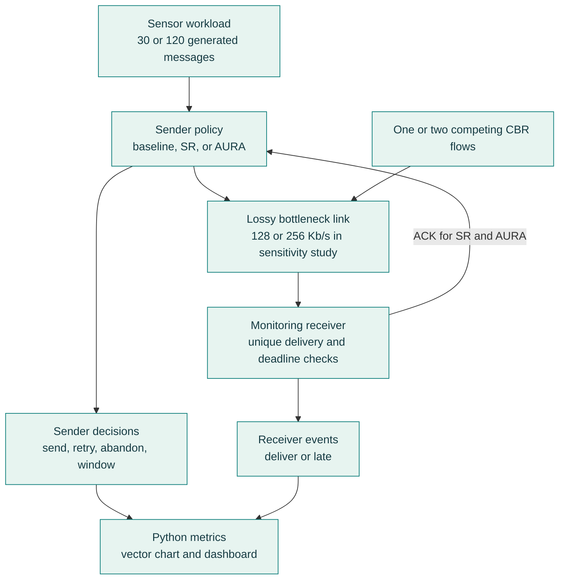
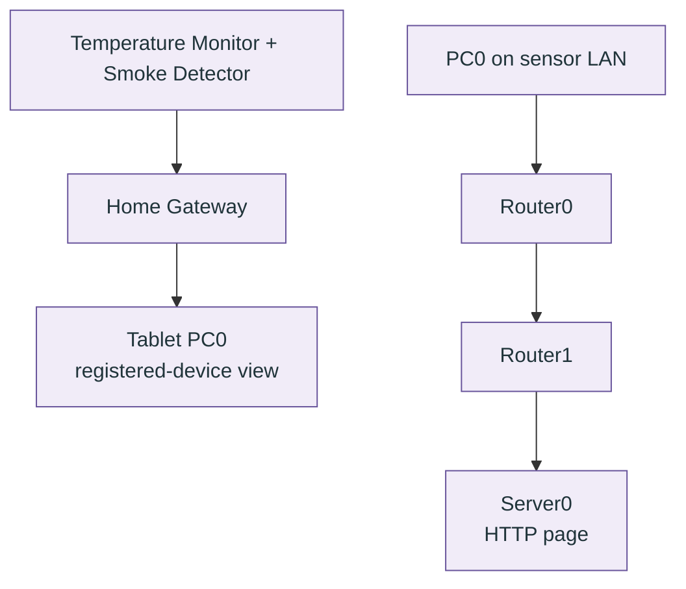
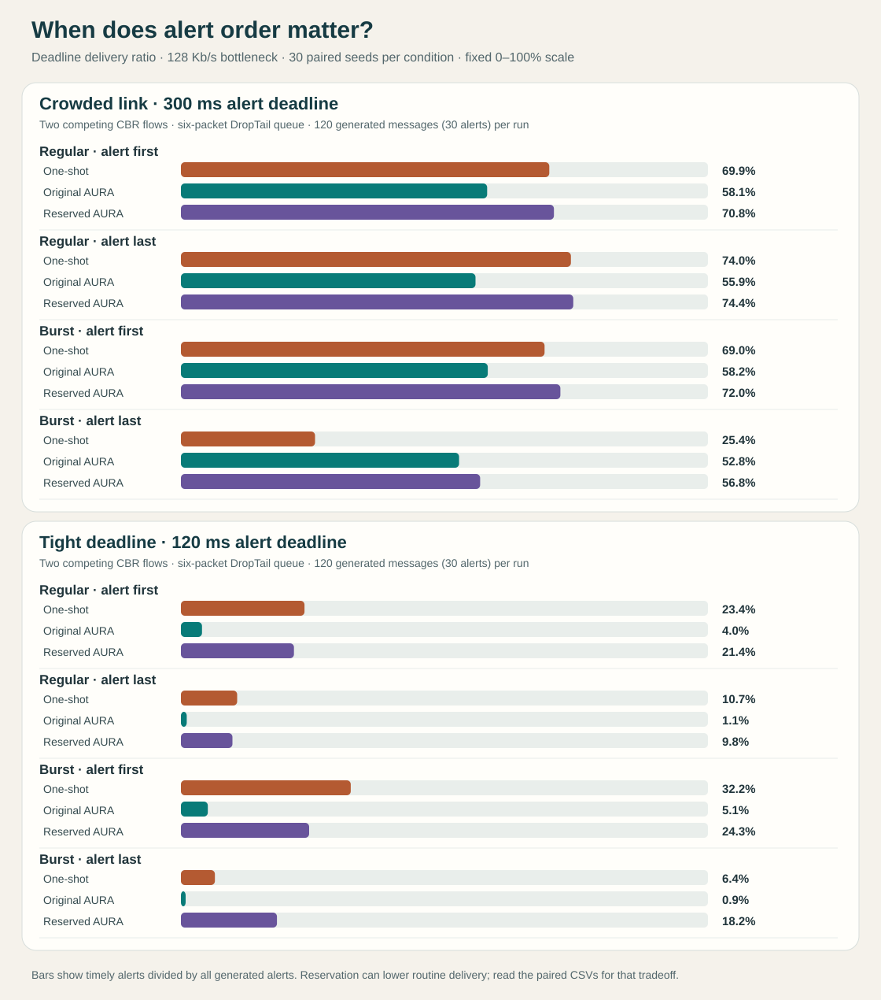

# AURA-UDP

[](https://github.com/purvi126/AURA-UDP/actions/workflows/python.yml)

[Download the v1.2.0 research evaluation release](https://github.com/purvi126/AURA-UDP/releases/tag/v1.2.0), a stable rollback checkpoint with the editable Packet Tracer topology and the first 1,260 NS2 runs. The current `main` branch adds [480 longer, crowded runs](experiments/results/robustness/summary.csv), a [360-run alert-reservation study](experiments/results/reservation/summary.csv), a [1,440-run arrival and link-rate study](experiments/results/sensitivity/summary.csv), and a Packet Tracer smoke stimulus device. The earlier [v1.1.0](https://github.com/purvi126/AURA-UDP/releases/tag/v1.1.0) and [v1.0.0](https://github.com/purvi126/AURA-UDP/releases/tag/v1.0.0) releases remain available.

**Release status:** The latest AURA admission policy and research evaluations are committed on `main`. On 2026-10-29, the Packet Tracer smoke-response tests were completed successfully. Physical activation of the Old Car increased the gateway Smoke Level from approximately `0.000073422` (Alarm red) to `100` (Alarm green). In a separate manual smoke adjustment test, the gateway Smoke Level increased from approximately `3.08169` (Alarm red) to `66.8725` (Alarm green). Before-and-after screenshots are saved in `packet_tracer/documentation/media/`, and a validated topology copy is available at [`AURA-UDP-campus-validated.pkt`](packet_tracer/topology/AURA-UDP-campus-validated.pkt). The saved topology's final physical device placement still requires confirmation. No newer release has been published; see the [validation record](docs/VALIDATION.md) and [desktop checklist](docs/PENDING_DESKTOP_CHECKS.md).

**Preparing for the final review?** Start with the [five-minute demonstration and evidence guide](docs/FINAL_REVIEW_GUIDE.md). The earlier [seven-page Review 2 PDF](docs/reviews/AURA-UDP-Review-2-70-percent-progress.pdf) and [editable Word document](docs/reviews/AURA-UDP-Review-2-70-percent-progress.docx) are a **15 October progress snapshot**, not the current project status. The approximately 70–75% figure in that report was a planning estimate, not a measured completion metric.

For setup and day-to-day use, see the [project and use guide](docs/START_HERE.md).

**Deadline-Aware Adaptive Reliable Transport for Critical IoT Communication Using NS2 and Cisco Packet Tracer**

This Computer Networks Lab project studies whether application-layer reliability and deadline awareness help safety alerts in a smart-campus network. **NS2 2.35 runs the transport experiment**: it compares one-shot datagrams, fixed Selective Repeat, and AURA. **Cisco Packet Tracer models the campus**: its editable topology shows routers, a server, an IoT gateway, and registered temperature and smoke devices. These are two complementary demonstrations, not one connected runtime. Start with the [plain-language project guide](docs/PROJECT_EXPLAINED.md) if the terms are new.

## Architecture

The same campus question is explored in two independent tools. **NS2 produces performance measurements. Packet Tracer demonstrates the physical layout and working endpoints.**

### NS2: where AURA actually runs



For SR and AURA, the receiver sends acknowledgments back to the source; the source controls retries and critical-alert deadlines. The other sender adds traffic at the bottleneck.

### Cisco Packet Tracer: where the campus is built



The sensor-to-gateway view and PC0-to-server HTTP route are **two separate checks** in the saved topology. No Packet Tracer sensor sends packets into NS2, and the Packet Tracer HTTP page does not execute AURA.

| Where to look | What is implemented there |
|---|---|
| [ns2/run.tcl](ns2/run.tcl) | NS2 nodes, links, loss, traffic, baseline/SR/AURA sender behavior, ACKs, deadlines, and event logs. |
| [scripts/multiseed.py](scripts/multiseed.py), [scripts/ablation.py](scripts/ablation.py), [scripts/robustness.py](scripts/robustness.py), [scripts/reservation_study.py](scripts/reservation_study.py), [scripts/sensitivity.py](scripts/sensitivity.py), and [python/analysis/metrics.py](python/analysis/metrics.py) | Repeat NS2 runs, isolate policy choices, test crowded traffic, burst arrivals, and link capacity, and turn logs into measured results. |
| [python/dashboard/index.html](python/dashboard/index.html) | Explore the saved NS2 results and message events; it does not run a simulation. |
| [AURA-UDP-campus.pkt](packet_tracer/topology/AURA-UDP-campus.pkt) | Editable Cisco Packet Tracer campus with routed PCs, Server0, Home Gateway, Temperature Monitor, and Smoke Detector. |
| [server-index.html](packet_tracer/documentation/server-index.html) and [build guide](packet_tracer/documentation/BUILD_GUIDE.md) | Source of Server0's HTTP page, address plan, and steps to inspect the Packet Tracer paths. |

For the academic scope and likely reviewer questions, see [academic review notes](docs/ACADEMIC_REVIEW.md). The NS2/Packet Tracer topic sheet lists alternatives such as TCP/UDP comparisons and IoT protocols; this project evaluates a specific deadline-aware datagram policy and does not claim to implement those other topics.

Numbered datagrams and ACKs are carried by NS2 `Agent/Message` instances. The sender retries individually; the receiver suppresses duplicate delivery. AURA adds deadline-ordered alert admission, a routine-traffic guard, an explicit estimate of whether a retry can arrive in time, RTT-based timing, and a bounded 4–6-message congestion window. An **experimental alert-reservation policy** keeps one sender slot free when only routine messages are waiting. See the [policy specification](docs/PROTOCOL.md). The [evaluation](docs/RESEARCH_EVALUATION.md) reports where that change helps and where the one-shot baseline still wins.

## Requirements and quick start

- Ubuntu WSL with NS2 2.35 (`ns` on `PATH`)
- Python 3.10 or newer, standard library only
- Cisco Packet Tracer 9.0 for the separate topology demonstration

From `/mnt/d/projects/AURA-UDP`:

```bash
python3 -m unittest discover -s tests -v
python3 scripts/experiments.py --output experiments/results/sample
python3 scripts/multiseed.py
python3 scripts/ablation.py
python3 scripts/robustness.py
python3 scripts/reservation_study.py
python3 scripts/sensitivity.py
python3 scripts/sensitivity_contrasts.py
python3 python/analysis/plot.py experiments/results/sample/summary.csv experiments/plots/sample.svg
python3 scripts/plot_robustness.py
python3 scripts/plot_sensitivity.py
```

To use the dashboard, start a local server **from the repository root in a separate terminal** and leave it running:

```bash
python3 -m http.server 8000 --bind 127.0.0.1
```

Then open [the local dashboard](http://localhost:8000/python/dashboard/). It guides you through six steps: choose a network condition, compare transports, test the deadline rule, inspect alert reservation, vary the alert arrival order and link rate, and follow one recorded message. The step 05 deadline-delivery chart was [checked in Chrome](docs/VALIDATION.md) at desktop and mobile widths against all 16 saved scenarios. If the browser says the page cannot be reached, check that the server terminal is still running and that you started it from the repository root. On Windows, use `python -m http.server 8000 --bind 127.0.0.1`. The server is for local review, not deployment.

Run a single mode:

```bash
ns ns2/run.tcl aura 0.15 40 80 300 7 /tmp/aura-demo
python3 python/analysis/metrics.py /tmp/aura-demo/events.csv
```

The NS2 command arguments are `mode loss_probability delay_ms background_kbps deadline_ms seed output_directory [interval_ms] [policy] [message_count] [background_sources] [queue_limit] [schedule] [bottleneck_kbps]`. The defaults are 30 messages, one background source, a 12-packet queue, a regular schedule, and a 128 Kb/s bottleneck. The schedule can be `regular`, `regular_late_alert`, `burst_first_alert`, or `burst_late_alert`; burst schedules require a message count divisible by four. Background sources can be one or two and split the configured total CBR rate. Policy variants apply only to AURA; `full` is the default and `reserved_alert_slot` is the experimental candidate. The output contains `events.csv`, `control.csv`, `background.csv`, `ns2.tr`, and `ns2.nam`. NAM is optional for analysis. Each mode uses the same configured topology and generation schedule, with paired seed indices for the loss streams; transport choices can consume different draws, so individual packet losses are not identical.

## Measured sample

The checked-in sample comes from `loss=0.15`, `delay=40 ms`, `background=80 Kb/s`, `deadline=300 ms`, `seed=7`. It is a single short run and supports no broad performance claim. Open [sample results](experiments/results/sample/summary.csv) and [the plot](experiments/plots/sample.svg). Re-run to regenerate them. Under a stronger scenario, `loss=0.3`, `delay=80 ms`, `background=180 Kb/s`, `deadline=120 ms`, `seed=11`, AURA did **not** improve DDR over the other modes; [stress results](experiments/results/stress/summary.csv) and [stress plot](experiments/plots/stress.svg) show the limitation.

## Demonstration

1. Run the tests and experiments above. Compare PDR, DDR, delay, retransmission overhead and goodput in the CSV and SVG.
2. Inspect `events.csv` for `generate`, `send`, `timeout`, `receive`, `duplicate`, `deliver`, `late`, `ack`, `expire`, and `abandon` transitions. `control.csv` shows retry timer and window decisions; `background.csv` records the competing flow's received packets.
3. Optionally open `ns2.nam` with NAM if installed; no result calculation depends on NAM.
4. Open the editable [Packet Tracer campus topology](packet_tracer/topology/AURA-UDP-campus.pkt). From sensor-side PC0, browse to `http://10.10.30.10` to verify HTTP across both routers. From Tablet PC0, browse to `http://192.168.25.1`, sign in to the lab gateway, and inspect the registered temperature and smoke devices. The [build guide](packet_tracer/documentation/BUILD_GUIDE.md) has the full address plan.

### Packet Tracer evidence, made readable


This vector diagram explains the topology. The [native PC0 capture](packet_tracer/documentation/media/routed-http-after-chamber-2026-10-29.jpg) shows the routed page after the chamber change. The [manual threshold capture](packet_tracer/documentation/media/smoke-manual-threshold-passed-2026-10-29.jpg) and [car-caused detector capture](packet_tracer/documentation/media/smoke-chamber-car-triggered-alarm-2026-10-29.jpg) show two separate alarms. The [gateway capture during the car alarm](packet_tracer/documentation/media/smoke-chamber-gateway-car-level100-2026-10-29.jpg) shows Smoke Level `100`. See the [validation record](docs/VALIDATION.md) for exact readings and limits.

**Final paired gateway evidence (2026-10-29):** Both smoke-response tests passed in Cisco Packet Tracer 9.0. The physical car test recorded gateway Smoke Level increasing from approximately `0.000073422` (Alarm red) to `100` (Alarm green). The separate manual smoke adjustment test recorded an increase from approximately `3.08169` (Alarm red) to `66.8725` (Alarm green).

- **Car test:** [Before](packet_tracer/documentation/media/smoke-chamber-gateway-before-car-2026-10-29.jpg) · [After](packet_tracer/documentation/media/smoke-chamber-gateway-after-car-2026-10-29.jpg)
- **Manual test:** [Before](packet_tracer/documentation/media/smoke-manual-gateway-before-2026-10-29.jpg) · [After](packet_tracer/documentation/media/smoke-manual-gateway-after-2026-10-29.jpg)
- **Validated Packet Tracer file:** [AURA-UDP-campus-validated.pkt](packet_tracer/topology/AURA-UDP-campus-validated.pkt)

These results demonstrate native Packet Tracer IoT behavior; the AURA transport protocol is evaluated separately in NS2.

## Current validation and limits

The [30-seed sweep](experiments/results/multiseed/summary.csv) covers moderate loss, tight deadlines, and twice the message rate: 270 NS2 runs. The [full comparison chart](experiments/plots/multiseed.svg) uses a fixed 0–100% scale for delivery ratios.


| Condition | Baseline DDR | Fixed SR DDR | AURA DDR |
|---|---:|---:|---:|
| Moderate loss | 81.7% | 83.3% | 93.3% |
| Tight deadline | 12.9% | 10.0% | 10.4% |
| High message rate | 86.3% | 73.3% | 89.2% |

AURA's PDR remained below fixed SR in all three conditions. The tight-deadline case shows a limit: all modes delivered few critical alerts on time, and baseline exceeded both reliable modes. The new feasibility decision reduced retry overhead under high message rate but did **not** improve measured DDR over the version without it.


See the [research evaluation and ablation](docs/RESEARCH_EVALUATION.md), [per-run results](experiments/results/multiseed/runs.csv), [paired differences](experiments/results/multiseed/paired.csv), and [settings](experiments/results/multiseed/config.json). These descriptive comparisons do not establish general superiority. Throughput and logical goodput use the same configured observation window for every mode within a condition.

A second **630-run validation set** uses seed indices 31–60. In its high-rate ablation, full AURA and the version without retry feasibility both reached 90.4% DDR; full AURA made fewer retry sends on average, but that set's paired interval includes zero. The [held-out ablation](experiments/results/holdout/ablation/summary.csv) and [held-out transport comparison](experiments/results/holdout/multiseed/summary.csv) keep the limitation visible.

### Longer workloads and two competing flows

The [480-run robustness sweep](experiments/results/robustness/config.json) uses 120 messages per run, 30 new seed indices (61–90), and four conditions. It compares one-shot delivery, fixed SR, full AURA, and AURA without the feasibility rule. Two conditions use two CBR competitors and a six-packet queue. The chart is SVG, so its labels remain sharp when opened or zoomed on GitHub.


| 120-message condition | One-shot DDR | Fixed SR DDR | AURA DDR | AURA without feasibility DDR |
|---|---:|---:|---:|---:|
| Moderate loss | 85.2% | 84.6% | 97.4% | 97.7% |
| High message rate | 85.6% | 27.0% | 86.4% | 85.3% |
| Two flows, short queue | **67.4%** | 6.8% | 56.2% | 54.3% |
| Two flows, tight deadline | **22.8%** | 4.2% | 4.3% | 4.3% |

Under two-flow congestion, AURA's DDR is **11.2 percentage points below** one-shot delivery (paired 95% interval −15.4 to −7.0 points). Under the tight deadline it is 18.4 points below (−20.8 to −16.1). The retry feasibility rule saved 0.022 and 0.019 extra sends per generated message in the high-rate and two-flow congestion conditions, respectively; its DDR difference from AURA without feasibility has an interval crossing zero in both. These results narrow the claim: AURA helps in some settings, while its retries and queueing can make critical alerts worse in crowded conditions. See [methods and interpretation](docs/RESEARCH_EVALUATION.md), [per-run data](experiments/results/robustness/runs.csv), and [paired intervals](experiments/results/robustness/paired.csv).

### A measured response to alert starvation

The crowded traces suggested that routine messages occupy every sender-window slot while new critical alerts wait. The new `reserved_alert_slot` candidate leaves one of the 4–6 slots available when it admits routine messages. This lets the next critical alert start without waiting for a routine ACK or timeout. It changes **sender admission only**; the router still uses DropTail, and no network priority is assumed.

The [reservation study](experiments/results/reservation/config.json) repeats the same four 120-message conditions with **30 new seed indices, 121–150**. All three modes in each row use matched traffic settings and seed indices. These runs were collected after the 61–90 robustness results; the original `full` policy and those results remain intact.

| Condition | One-shot DDR | Original AURA DDR | Reserved AURA DDR | Reserved routine delivery |
|---|---:|---:|---:|---:|
| Moderate loss | 84.0% | 96.4% | 96.7% | 100.0% |
| High message rate | 84.2% | 85.9% | 89.4% | 100.0% |
| Two flows, short queue | 69.6% | 55.8% | **69.8%** | 63.3% |
| Two flows, tight deadline | **25.6%** | 4.3% | 22.2% | 59.0% |

Against original AURA, reservation raises DDR by 14.0 points in the two-flow short-queue case (paired 95% interval 9.1–18.7) and 17.9 points in the tight case (15.3–20.7). The short-queue result is approximately level with one-shot delivery: reserved minus baseline is 0.2 points (−3.7 to 4.1). **In the tight case one-shot still wins:** reserved minus baseline is −3.3 points (−6.4 to −0.3). Reservation also lowers routine delivery from 77.9% to 63.3% and from 73.0% to 59.0% in those two cases. This is a measured alert-versus-routine tradeoff, not broad superiority. The [per-run data](experiments/results/reservation/runs.csv) and [paired intervals](experiments/results/reservation/paired.csv) include retry cost and competing-flow outcomes; the [dashboard](python/dashboard/index.html) makes those columns inspectable.

### What changes when alerts arrive late in a burst?

The [sensitivity study](docs/RESEARCH_EVALUATION.md) uses 30 new seeds per condition. Each 120-message run has two competing CBR flows and a six-packet queue. Four schedules cross **regular versus burst arrivals** with **alert first versus last** in each group of four. Burst messages are 5 ms apart and groups start four intervals apart, preserving nominal average load. The table below shows the constrained 128 Kb/s link; the [full summary](experiments/results/sensitivity/summary.csv) also covers 256 Kb/s. DDR counts timely critical deliveries out of **all 30 generated critical messages**.



The chart is generated directly from the saved CSV by [plot_sensitivity.py](scripts/plot_sensitivity.py), so its labels remain sharp when enlarged on GitHub.

| Workload | Arrival pattern | One-shot DDR | Original AURA DDR | Reserved AURA DDR |
|---|---|---:|---:|---:|
| Crowded | Regular, alert first | 69.9% | 58.1% | 70.8% |
| Crowded | Regular, alert last | 74.0% | 55.9% | 74.4% |
| Crowded | Burst, alert first | 69.0% | 58.2% | 72.0% |
| Crowded | Burst, alert last | 25.4% | 52.8% | 56.8% |
| Tight deadline | Regular, alert first | 23.4% | 4.0% | 21.4% |
| Tight deadline | Regular, alert last | 10.7% | 1.1% | 9.8% |
| Tight deadline | Burst, alert first | 32.2% | 5.1% | 24.3% |
| Tight deadline | Burst, alert last | 6.4% | 0.9% | 18.2% |

At 128 Kb/s in crowded traffic, moving an alert from first to last **within the same burst timing** lowers one-shot DDR by 43.6 percentage points (paired 95% interval −46.7 to −40.3) and reserved AURA DDR by 15.2 points (−19.7 to −10.7). Burst spacing with the alert **first** changes one-shot DDR by only −0.9 points (−3.2 to +1.4); the sharp penalty appears with the alert last. Reservation helps in that tested combination, but it lowers routine delivery from 77.6% under original AURA to 59.3%. Original AURA remains weak in tight-deadline cases even at 256 Kb/s. The [full methods](docs/RESEARCH_EVALUATION.md), [run data](experiments/results/sensitivity/runs.csv), [transport comparisons](experiments/results/sensitivity/paired.csv), and [schedule contrasts](experiments/results/sensitivity/schedule_pairs.csv) show the exact conditions and uncertainty. These are descriptive synthetic results, not a claim of general or Internet-safe performance.

The Packet Tracer file includes a DLC100 Home Gateway, native Temperature Monitor, Smoke Detector, and an Old Car smoke stimulus. After reconnecting `SMOKE-SENSOR`, both sensors appeared on the gateway Devices page. PC1 and PC2 each received four of four replies from Server0; PC3 received four of four replies from PC2. On 2026-10-29, PC0 again loaded the custom HTTP page from Server0 across both routers after the chamber change. The validated topology was reopened and inspected on 2026-10-29. Both `SMOKE-TRIGGER-CAR` and `SMOKE-SENSOR` are located in Main Wiring Closet. The car is OFF (`state = 0`), and the detector has recovered (`level = 0`, `state = 0`). The separate `SMOKE-TEST-CHAMBER` is empty in this saved version; earlier chamber-based test observations are retained in the validation history. A manual Smoke setting of `100` in Main Wiring Closet produced detector `level 69.21540069580078, state 1`. Later, physically activating the car in the chamber produced exhaust and detector `level 100, state 1`; the gateway showed Level `100` with a green Alarm indicator. Paired gateway before-and-after captures have now been completed for both physical car activation and manual smoke adjustment, with screenshots linked in the Packet Tracer evidence section above. See the [validation record](docs/VALIDATION.md) and [build guide](packet_tracer/documentation/BUILD_GUIDE.md). These are Packet Tracer connectivity and sensor observations, not transport performance measurements.

## Limits

The sender has a small bounded adaptive window; router queue priority, a custom C++ UDP header, and an Internet-grade congestion controller are not implemented. The 30-seed bootstrap intervals describe these workloads and are not confirmatory significance tests. The two-flow Jain score compares the two CBR background flows, not AURA against a congestion-controlled peer. The logical 64-byte goodput assumption is documented. See the [engineering review](docs/ENGINEERING_REVIEW.md) for corrected issues, security scope, and remaining limits, and [progress](docs/AI_SETUP_PROGRESS.md) for the implementation record.

MIT licensed; see [LICENSE](LICENSE).

For a published checkpoint or safe recovery, see the [rollback guide](docs/ROLLBACK.md).
