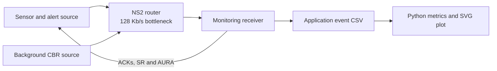
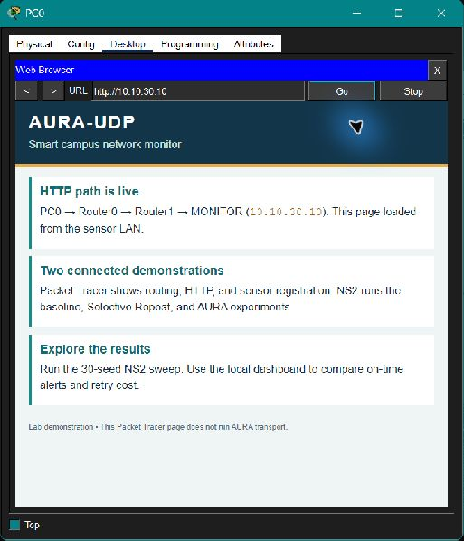

# AURA-UDP

[](https://github.com/purvi126/AURA-UDP/actions/workflows/python.yml)

[Download the verified v1.1.0 release](https://github.com/purvi126/AURA-UDP/releases/tag/v1.1.0), including the editable Packet Tracer topology, measured 30-seed CSVs, and readable evidence visuals. The earlier [v1.0.0 release](https://github.com/purvi126/AURA-UDP/releases/tag/v1.0.0) remains a rollback checkpoint.

**Deadline-Aware Adaptive Reliable Transport for Critical IoT Communication Using NS2 and Cisco Packet Tracer**

This Computer Networks Lab project studies whether application-layer reliability and deadline awareness help safety alerts in a smart-campus network. It compares one-shot datagrams, fixed Selective Repeat, and an adaptive deadline-aware variant in **NS2 2.35**. A separate [Packet Tracer build guide](packet_tracer/documentation/BUILD_GUIDE.md) explains a campus connectivity demonstration. Packet Tracer does not implement AURA.

## Architecture



Numbered datagrams and ACKs are carried by real NS2 `Agent/Message` instances. The sender controls a four-message window, retries individually and suppresses duplicate delivery. AURA adds critical-first admission, absolute deadlines, RTT-based RTO, Karn's rule and timeout backoff. See [protocol details](docs/PROTOCOL.md). The novelty here is the *combination and evaluation* of established mechanisms in this lab scenario; no claim of a new transport standard is made.

## Requirements and quick start

- Ubuntu WSL with NS2 2.35 (`ns` on `PATH`)
- Python 3.10 or newer, standard library only
- Cisco Packet Tracer 9.0 for the separate topology demonstration

From `/mnt/d/projects/AURA-UDP`:

```bash
python3 -m unittest discover -s tests -v
python3 scripts/experiments.py --output experiments/results/sample
python3 scripts/multiseed.py
python3 python/analysis/plot.py experiments/results/sample/summary.csv experiments/plots/sample.svg
```

To use the dashboard, start a local server **from the repository root in a separate terminal** and leave it running:

```bash
python3 -m http.server 8000 --bind 127.0.0.1
```

Then open [the local dashboard](http://localhost:8000/python/dashboard/). It guides you through three steps: choose a network condition, compare outcomes, and follow one recorded message. If the browser says the page cannot be reached, check that the server terminal is still running and that you started it from the repository root. On Windows, use `python -m http.server 8000 --bind 127.0.0.1`. The server is for local review, not deployment.

Run a single mode:

```bash
ns ns2/run.tcl aura 0.15 40 80 300 7 /tmp/aura-demo
python3 python/analysis/metrics.py /tmp/aura-demo/events.csv
```

The NS2 command arguments are `mode loss_probability delay_ms background_kbps deadline_ms seed output_directory [interval_ms]`. The output contains `events.csv`, `ns2.tr`, and `ns2.nam`. NAM is optional for analysis. Modify the arguments to vary loss, delay, congestion, message rate and deadlines. Each mode uses the same configured topology, traffic schedule and initial seed.

## Measured sample

The checked-in sample comes from `loss=0.15`, `delay=40 ms`, `background=80 Kb/s`, `deadline=300 ms`, `seed=7`. It is a single short run and supports no broad performance claim. Open [sample results](experiments/results/sample/summary.csv) and [the plot](experiments/plots/sample.svg). Re-run to regenerate them. Under a stronger scenario, `loss=0.3`, `delay=80 ms`, `background=180 Kb/s`, `deadline=120 ms`, `seed=11`, AURA did **not** improve DDR over the other modes; [stress results](experiments/results/stress/summary.csv) and [stress plot](experiments/plots/stress.svg) show the limitation.

## Demonstration

1. Run the tests and experiments above. Compare PDR, DDR, delay, retransmission overhead and goodput in the CSV and SVG.
2. Inspect `events.csv` for `generate`, `send`, `timeout`, `receive`, `duplicate`, `deliver`, `late`, `ack`, and `expire` transitions.
3. Optionally open `ns2.nam` with NAM if installed; no result calculation depends on NAM.
4. Open the editable [Packet Tracer campus topology](packet_tracer/topology/AURA-UDP-campus.pkt). From sensor-side PC0, browse to `http://10.10.30.10` to verify HTTP across both routers. From Tablet PC0, browse to `http://192.168.25.1`, sign in to the lab gateway, and inspect the registered temperature and smoke devices. The [build guide](packet_tracer/documentation/BUILD_GUIDE.md) has the full address plan.

### Packet Tracer evidence, made readable


The diagram summarizes two checks in the saved topology. Inspect the [PC0 routed HTTP capture](packet_tracer/documentation/media/routed-http-pc0.jpg) and [Home Gateway device capture](packet_tracer/documentation/media/gateway-devices.jpg) for Packet Tracer UI evidence. An older [PC3 capture](packet_tracer/documentation/media/server-http.jpg) shows HTTP from a client on the **same server LAN**, so it is not evidence of routing. Packet Tracer's UI captures remain small; the diagram makes their paths and device names readable. See the [build guide](packet_tracer/documentation/BUILD_GUIDE.md) for the address plan and steps.



The page itself now uses larger type and shorter explanations. The title bar identifies PC0; the address field shows Server0 at `10.10.30.10`.

## Current validation and limits

The [30-seed sweep](experiments/results/multiseed/summary.csv) covers moderate loss, tight deadlines, and twice the message rate: 270 NS2 runs. The [full comparison chart](experiments/plots/multiseed.svg) uses a fixed 0–100% scale for delivery ratios.


| Condition | Baseline DDR | Fixed SR DDR | AURA DDR |
|---|---:|---:|---:|
| Moderate loss | 86.3% | 86.7% | 91.7% |
| Tight deadline | 16.3% | 12.1% | 12.9% |
| High message rate | 88.3% | 65.8% | 90.0% |

AURA's PDR remained below fixed SR in all three conditions. The tight-deadline case shows a limit: all modes delivered few critical alerts on time, and baseline exceeded both reliable modes. See the [per-run results](experiments/results/multiseed/runs.csv), [paired differences](experiments/results/multiseed/paired.csv), and [settings](experiments/results/multiseed/config.json). These descriptive comparisons do not establish general superiority. Throughput and logical goodput use the same configured observation window for every mode within a condition.

The Packet Tracer file includes a DLC100 Home Gateway, native Temperature Monitor, and Smoke Detector. Both sensors have wireless links and appear by name in the gateway's device list on Tablet PC0. The tablet showed their temperature and smoke-level fields. PC1 and PC2 each received four of four replies from Server0; PC3 received four of four replies from PC2. PC0 loaded the custom HTTP page from Server0 across both routers, and PC3 loaded it on the server LAN. See the [validation record](docs/VALIDATION.md). These are connectivity observations in Packet Tracer, not transport performance measurements.

## Limits

No adaptive window sizing, router queue priority, custom C++ UDP header, or statistical significance test is implemented. The logical 64-byte goodput assumption is documented. See the [engineering review](docs/ENGINEERING_REVIEW.md) for corrected issues, security scope, and remaining limits, and [progress](docs/AI_SETUP_PROGRESS.md) for the implementation record.

MIT licensed; see [LICENSE](LICENSE).

For a published checkpoint or safe recovery, see the [rollback guide](docs/ROLLBACK.md).
